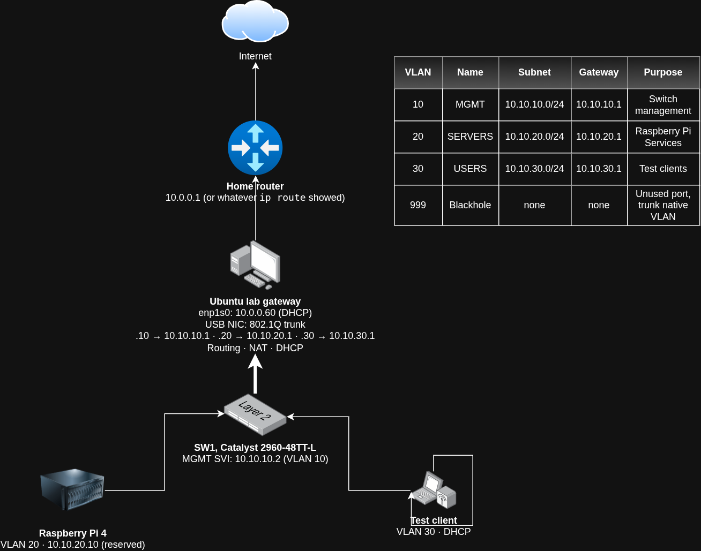

# NOC Home Lab

A segmented, monitored network built on a Cisco Catalyst 2960 and Ubuntu, run like a NOC shift: VLANs, routing, core services, monitoring, alerting, and documented incident drills. Built alongside CompTIA Network+ (N10-009) study.

## Topology

## Status
- [x] Phase 1: Baseline and harden the switch
- [x] Phase 2: Segment the network (VLANs, trunk, Linux routing, NAT, DHCP)
- [x] Phase 3: Core services (DNS, NTP, syslog, config backups)
- [x] Phase 4: Monitoring and alerting (Grafana dashboard still to come)
- [x] Phase 5: Incident drills (6 drills + 1 real incident)
- [x] Phase 6: Final write-up

## Hardware
| Device | Role |
|---|---|
| Cisco WS-C2960-48TT-L, IOS 12.2(55)SE12 (LAN Base k9) | Access switch, 802.1Q trunk to the router |
| Ubuntu 26.04 desktop (Lenovo ThinkCentre) | Router-on-a-stick, NAT, DHCP, syslog, TFTP |
| Raspberry Pi 4, Raspberry Pi OS Lite (64-bit) | DNS (Pi-hole), NTP (chrony) |
| USB 3.0 gigabit Ethernet adapter | Ubuntu's trunk port to the switch |

## Network design
The Ubuntu desktop's onboard NIC (`enp1s0`) connects to the home network (`10.0.0.0/24`) for internet access. A USB NIC carries an 802.1Q trunk to the switch's Gi0/1, and Ubuntu routes between the lab VLANs and NATs them out to the internet.

| VLAN | Name | Subnet | Gateway | Purpose |
|---|---|---|---|---|
| 10 | MGMT | 10.10.10.0/24 | 10.10.10.1 | Switch management (SVI 10.10.10.2) |
| 20 | SERVERS | 10.10.20.0/24 | 10.10.20.1 | Raspberry Pi (reserved 10.10.20.10) |
| 30 | USERS | 10.10.30.0/24 | 10.10.30.1 | Test clients (DHCP 10.10.30.100-200) |
| 999 | BLACKHOLE | none | none | Unused ports and trunk native VLAN |

## Services
| Service | Software | Host | Address | Port / Protocol |
|---|---|---|---|---|
| Inter-VLAN routing + NAT | Linux kernel + nftables | Ubuntu | 10.10.x.1 | n/a |
| DHCP | dnsmasq | Ubuntu | VLANs 20, 30 | UDP 67 |
| DNS + ad blocking | Pi-hole | rpi4 | 10.10.20.10 | UDP/TCP 53 |
| Pi-hole admin | Pi-hole web | rpi4 | 10.10.20.10 | TCP 80/443 |
| NTP | chrony | rpi4 | 10.10.20.10 | UDP 123 |
| Syslog collector | rsyslog | Ubuntu | 10.10.10.1 | UDP 514 |
| Config archive | tftpd-hpa | Ubuntu | 10.10.10.1 | UDP 69 |
| SNMPv3 agents (authPriv, SHA/AES) | IOS / snmpd | SW1, rpi4 | 10.10.10.2, 10.10.20.10 | UDP 161 |
| Monitoring and graphing | LibreNMS (Docker) | Ubuntu | localhost | TCP 8000 |
| Service checks | Uptime Kuma (Docker) | rpi4 | 10.10.20.10 | TCP 3001 |
| Alerting | Discord webhook | — | — | HTTPS |
| Management | SSH v2 | SW1, rpi4 | 10.10.10.2, 10.10.20.10 | TCP 22 |

## Phase 1: Baseline and harden the switch
- Factory reset, console access, SSH v2 only, Telnet and HTTP disabled, local auth with hashed secrets
- Unused ports shut and parked in VLAN 999, DTP disabled, Smart Install (`vstack`) disabled
- Baseline config: [configs/sw1-baseline.txt](configs/sw1-baseline.txt)
- Hardening checklist: [docs/hardening-checklist.md](docs/hardening-checklist.md)

## Phase 2: Segment the network
- VLANs 10/20/30/999, access ports with PortFast and BPDU Guard, Rapid PVST+
- Gi0/1 trunk to Ubuntu with native VLAN 999 (mitigates double-tagging)
- Ubuntu VLAN subinterfaces (netplan), IP forwarding, NAT and a forward-filter rule (nftables), DHCP (dnsmasq)
- Configs: [netplan](configs/ubuntu/60-lab.yaml), [nftables](configs/ubuntu/nftables.conf), [dnsmasq](configs/ubuntu/dnsmasq-lab.conf), [switch running config](configs/sw1-running.txt)
- Proof: [show vlan brief](docs/phase2/show-vlan-brief.txt), [show interfaces trunk](docs/phase2/show-interfaces-trunk.txt)

## Phase 3: Core services
- Pi-hole as lab DNS, handed out through DHCP, answering all lab VLANs
- chrony on the Pi as the lab time source; SW1 synced over NTP with local-time log timestamps
- SW1 logs sent to rsyslog on Ubuntu, one file per device, with log rotation
- Config backups: SW1 pushes its config over TFTP on every save and daily; [a script](scripts/sw1-backup.sh) redacts secrets, filters noise lines, and commits only real changes. Runs nightly from cron.
- Configs: [chrony](configs/rpi4/chrony-lab.conf), [rsyslog](configs/ubuntu/10-lab-network.conf), [logrotate](configs/ubuntu/logrotate-lab-network)
- Proof: [show ntp associations](docs/phase3/show-ntp-associations.txt), [sample switch syslog](docs/phase3/sample-switch-syslog.txt), and the switch config history in this repo's commits

## Phase 4: Monitoring and alerting
- SNMPv3 authPriv (SHA / AES-128) on SW1 and rpi4, with a read-only user and an ACL limiting SNMP to the poller
- LibreNMS polls both devices every 5 minutes and graphs every port; alert rules for device down, SNMP unreachable, port down, interface errors, and latency, delivered to Discord with recovery notices
- Uptime Kuma on rpi4 checks services every 60 seconds (Pi-hole DNS and admin, SW1 ping and SSH, LibreNMS itself), from a different host than LibreNMS
- Performance baseline with iperf3: ~94 Mbps across the 100 Mbps bottleneck, 0% UDP loss, 0.014 ms jitter
- Details: [LibreNMS](docs/phase4/librenms.md) · [Uptime Kuma](docs/phase4/uptime-kuma.md) · [Baseline](docs/phase4/baseline.md)

## Phase 5: Incident drills
Each fault was introduced on purpose, caught by monitoring (or not), and worked as a ticket with CompTIA's 7-step troubleshooting method. Times come from switch syslog, service journals, and Discord alert timestamps.

| Drill | Layer | MTTD | MTTR | Ticket |
|---|---|---|---|---|
| Server port shut and in wrong VLAN | L2 | ~3 min | ~22 min | [DRILL-01](incidents/drill-01-wrong-vlan.md) |
| Speed/duplex mismatch | L1 | not alerted, found via baseline | ~35 min | [DRILL-02](incidents/drill-02-duplex-mismatch.md) |
| VLAN pruned from trunk | L2 | ~1 min | ~7 min | [DRILL-03](incidents/drill-03-trunk-pruned.md) |
| Port security violation | Security | 24 sec | ~7 min | [DRILL-04](incidents/drill-04-port-security.md) |
| DNS outage | L7 | ~1 min | ~6 min | [DRILL-05](incidents/drill-05-dns-outage.md) |
| Port down (cable pulled) | L1 | < 1 min | ~9 min | [DRILL-06](incidents/drill-06-port-down.md) |

Also filed as [GitHub Issues](https://github.com/JordanTolliver-88/noc-home-lab/issues?q=label%3Aincident).

**Runbooks:** [Device unreachable on an access port](runbooks/port-down.md) · [Device reachable but slow](runbooks/slow-link.md) · [VLAN missing on a trunk](runbooks/trunk-vlan.md) · [Port err-disabled](runbooks/err-disabled.md) · [DNS outage](runbooks/dns-outage.md)

**What the drills showed:**
- Up/down monitoring can't see a degraded link. The duplex mismatch cut throughput 24% with no alert.
- Port alerts fire for `notconnect` and `err-disabled` ports, but not for ports an admin shut down.
- A monitor inside an outage can detect it but can't report it, and may blame healthy devices.
- A real, unplanned incident ([INC-008](shift-log.md)): the lab router suspended overnight, taking routing, DHCP, monitoring, and alerting down for 16 hours with no alert. Fixed by disabling sleep; the single point of failure is documented.

## Incident log
See [shift-log.md](shift-log.md) for incidents worked during the build.

## Skills demonstrated
Cisco IOS switching (VLANs, 802.1Q trunking, Rapid PVST+, port security, hardening) · Linux networking (netplan, nftables, IP forwarding, NAT) · DHCP, DNS, NTP, syslog, TFTP · SNMPv3 · LibreNMS and Uptime Kuma monitoring with Discord alerting · iperf3 performance baselining · Incident response with the CompTIA troubleshooting method, MTTD/MTTR tracking, and runbooks · Bash scripting, cron, Docker, Git-based configuration management